# Práctica 4: Gestión Avanzada de Ramas y Resolución de Conflictos

**Hugo Martín Toledano - 2º DAW**

---

# Fase base

He creado el proyecto WebNova, iniciado el repositorio y realizado el primer commit.

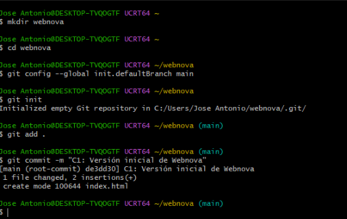

Así quedó el `index.html` inicial.

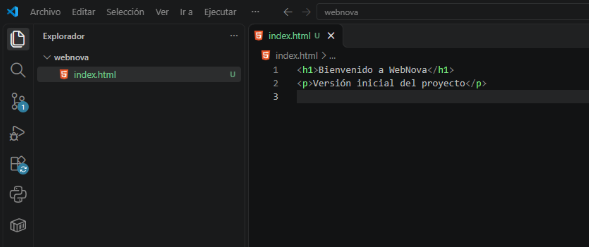

---

# Parte 1: Desarrollo en paralelo

He creado las ramas `cabecera`, `contenido` y `pie` a partir de `main`.

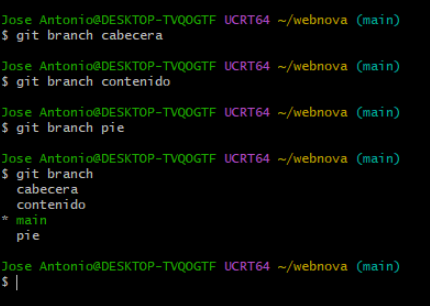

## Rama cabecera

He creado `header.html` y guardado el cambio en C2.

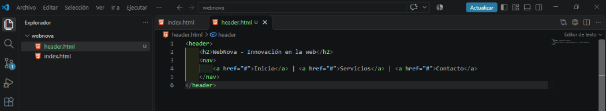

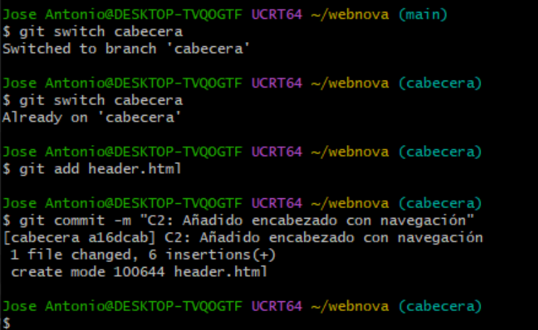

## Rama contenido

He creado `content.html` y guardado el cambio en C3.

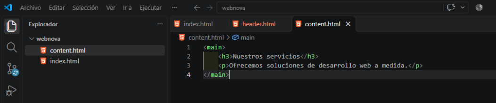

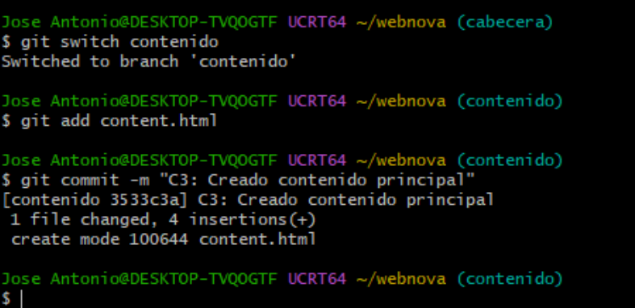

## Rama pie

He creado `footer.html` y guardado el cambio en C4.

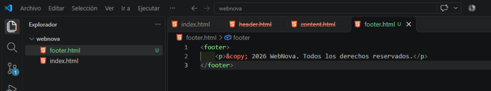

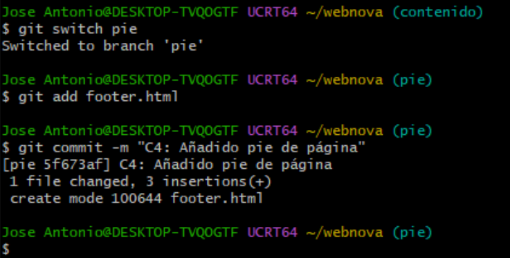

---

# Parte 2: Integración

He vuelto a `main` y he unido las tres ramas.

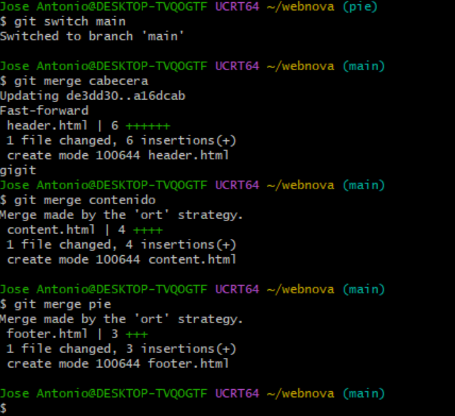

Después he juntado todo el contenido dentro de `index.html`.

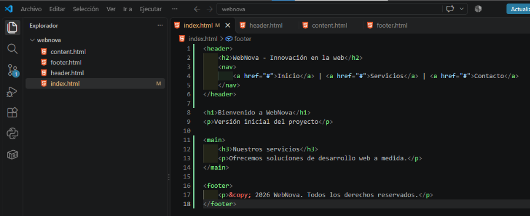

He creado C5 y eliminado las ramas que ya no hacían falta.

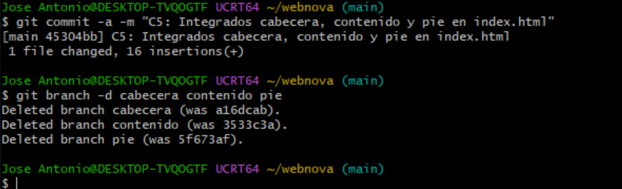

---

# Parte 3: Conflicto y resolución

He creado la rama `rediseño` y cambiado el título principal.

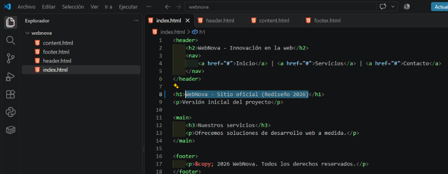

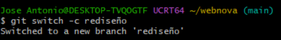

He guardado el cambio en C6.

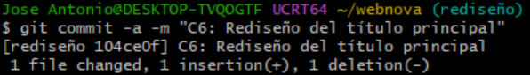

Después he vuelto a `main` y cambiado la misma línea de otra forma.

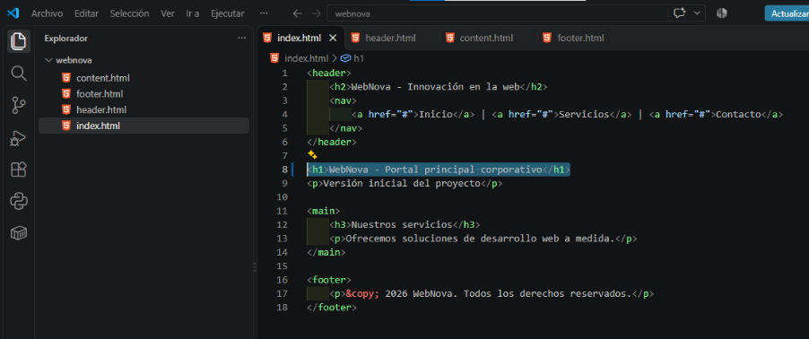

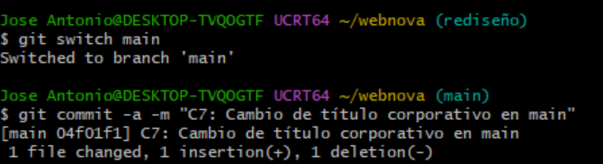

Al intentar unir `rediseño` con `main`, apareció un conflicto.

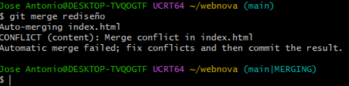

En `index.html` aparecieron las dos versiones del título.

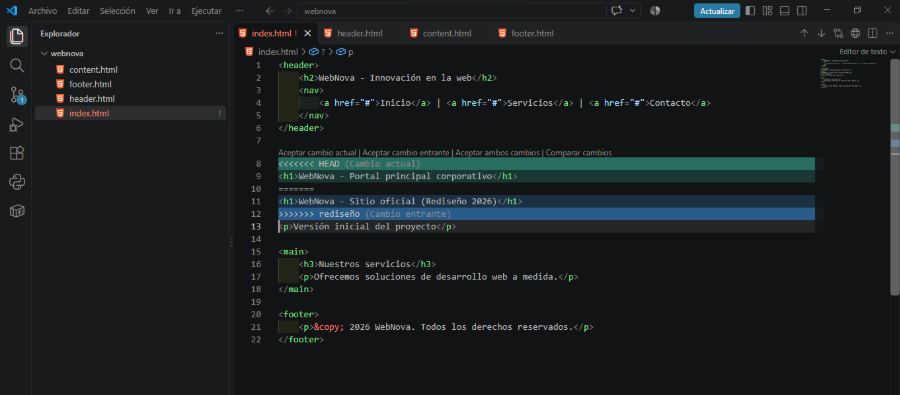

He unido las dos ideas y dejado el título definitivo.

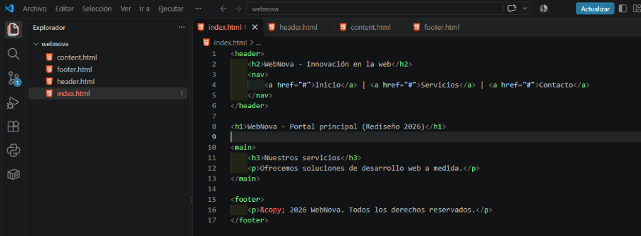

Después he guardado la solución en C8.

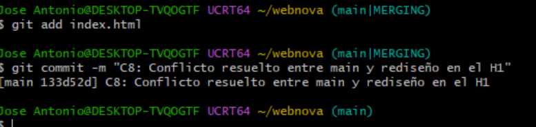

---

# Parte 4: Historial

Este es el historial final de ramas y cambios de la práctica.

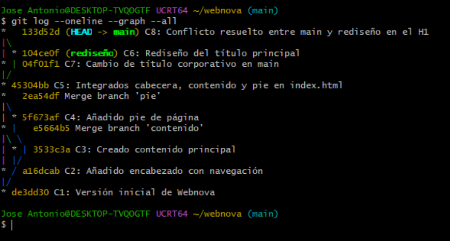

---

# Reflexión teórica

## ¿Por qué ocurrió el conflicto en la Parte 3 y no en la Parte 2?

En la Parte 2 cada rama trabajaba con archivos diferentes, así que Git pudo unirlas, pero en la Parte 3, `main` y `rediseño` cambiaron la misma línea de `index.html` de formas diferentes, por eso apareció el conflicto.

## ¿Qué ocurrió con los archivos al ejecutar `git switch main`?

Al volver a `main`, los archivos cambiaron a la versión que tenía guardada esa rama. El cambio que había hecho en `rediseño` dejó de aparecer hasta que las ramas se unieron.